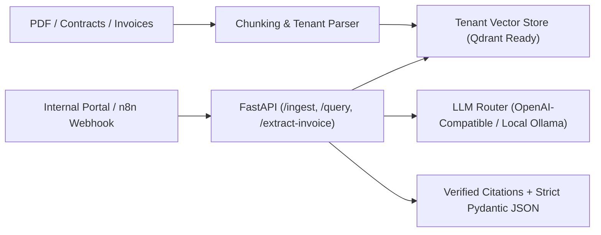

# Enterprise RAG & Document Extraction Copilot (FastAPI + Qdrant)

[](https://github.com/agenciaiaonline-wq/enterprise-rag-fastapi-starter/actions/workflows/ci.yml)
[](app/main.py)
[](Dockerfile)
[](LICENSE)

> **Zero-retention enterprise document intelligence & structured invoice/contract JSON extraction for legal, finance, healthcare, and operations teams.**

Benchmarked against enterprise self-hosted RAG & OCR extraction patterns (`enterprise-rag-boilerplate`, `invoice-extractor`), this codebase provides strict multi-tenant scoping (`tenant_id`), deterministic chunk retrieval with grounded citations, and structured invoice JSON extraction.

---

## Architecture



---

## API Endpoints & Example Payloads

| Method & Route | Purpose |
| :--- | :--- |
| `GET /health` | Service readiness probe |
| `POST /ingest` | Chunk and index tenant-scoped document pages |
| `POST /query` | Retrieve strictly tenant-isolated citations (`top_k`) + grounded summary |
| `POST /extract-invoice` | Extract vendor, invoice ID, currency, total amount, and due date into typed JSON |

```bash
# Query tenant-scoped corporate knowledge base
curl -s -X POST http://127.0.0.1:8000/query \
  -H "Content-Type: application/json" \
  -d '{"tenant_id":"demo-corp","question":"vendor contracts approval threshold","top_k":3}'
```

Sample `POST /extract-invoice` output from [`examples/sample_invoice_ocr.txt`](examples/sample_invoice_ocr.txt):
```json
{
  "vendor_name": "Northwind Cloud Infrastructure LLC",
  "invoice_number": "NW-2026-089",
  "currency": "USD",
  "total_amount": 4250.75,
  "due_date": "2026-12-30"
}
```

---

## Quick Start

```bash
cp .env.example .env
python3 -m unittest discover -s tests -v
docker compose -f docker-compose.example.yml up -d
# Interactive Swagger UI: http://127.0.0.1:8000/docs
```

---

## Request Custom RAG Deployment (`USD 4,500 - 12,000`)
- **LinkedIn Studio:** [Golden Nodalix Studio](https://www.linkedin.com/in/agency-golden-nodalix-880598438/)
- **Profile Hub:** [agenciaiaonline-wq](https://github.com/agenciaiaonline-wq)
- **Email:** `studio@example.com`
